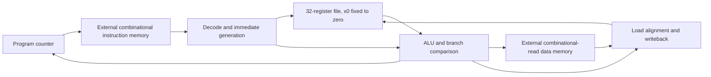

# RV32I Single-Cycle CPU Core

I use a Python reference model to check this single-cycle SystemVerilog core instruction by instruction. The regression includes directed programs, ten random seeds, trap checks and three RTL mutation tests. Lint and generic Yosys synthesis pass. I also run a [Nangate45 physical implementation experiment](physical/README.md) and an optional [UPF/output-isolation experiment](power/README.md).

## Architecture



The core executes one instruction per clock while running. Instruction and data memories are external and must provide combinational reads. Decode, register file, ALU, immediate generation and control are contained in `rtl/rv32i_core.sv`. See [the specification](SPEC.md) for ports, supported instructions, reset and trap behavior.

## Run

Dependencies: Python 3 (standard library only), Icarus Verilog, Verilator and Yosys. Tested versions are recorded in [results](docs/results/versions.txt).

```sh
# macOS with an existing Homebrew installation
brew install icarus-verilog verilator yosys
bash scripts/check.sh
# Individual steps
verilator --lint-only -Wall rtl/rv32i_core.sv
python3 scripts/regress.py
python3 scripts/mutations.py
```

`check.sh` runs lint, regression, generic synthesis with structural checks, and isolated mutation tests. Commands exit nonzero on failure. Generated programs, traces, memory/register dumps and logs are in `build/`; comparison failures are rerun to save a VCD. A hung simulator fails after a 30-second host timeout (a zero-time scheduling hang may not produce a useful waveform).

## Verification evidence

| Check | Observed result |
|---|---|
| Verilator lint | PASS with `-Wall` |
| Directed, random and trap programs | 30 PASS; 13,007 retirements compared |
| Random reproducibility | Seeds 0 through 9; generator checked into source |
| Instruction/outcome bins | Every supported non-trapping operation and both outcomes of all six branches observed |
| Architectural comparison | Every retirement, memory request, final register and memory contents |
| Trap behavior | Illegal instructions, ECALL/EBREAK, instruction/load/store alignment; sticky halt and reset recovery |
| Negative tests | Arithmetic shift, subtraction and store-byte-lane mutations detected |
| Yosys | Generic synthesis and `check -assert` PASS |

The checked-in [result summary](docs/results/summary.json), [logs](docs/results/regression.log), [synthesis log](docs/results/synthesis.log), and [source hashes](docs/results/source-sha256.txt) identify this local run. The operation bins record exercised instructions and branch outcomes; they do not measure code coverage. I use a custom Python model, so shared RTL/model errors remain a risk. Official architectural tests, formal verification, FPGA validation and gate-level timing simulation have not been run.

### A bug the tests found

The first directed run caught SRA returning `0x40000000` instead of `0xc0000000` when shifting a negative operand. A mixed signed/unsigned ternary expression caused the arithmetic shift to use unsigned expression context. I replaced it with explicit branches. A mutation that restores logical shifting fails the same retirement comparison. I also separated effective-address calculation from load-result decoding to remove a combinational scheduling loop seen in Icarus.

## Scope and next milestone

This core has no interrupts, privileged execution, CSRs, caches, wait-state interface or ISA extensions. ECALL/EBREAK halt into a documented test execution environment. Reset is synchronous and clears registers. The core cannot directly connect to synchronous-read block RAM without architectural changes.

I have run Yosys mapping, OpenROAD placement/CTS/routing, extracted timing with its integrated OpenSTA, and KLayout GDS generation on the public Nangate45 platform. [Recorded physical results](physical/README.md) include cell area, setup/hold slack, vectorless power estimates and physical-check findings. The core-only timing budget excludes external memory implementation. Nangate45 is non-manufacturable; these results are not tapeout signoff. Design Compiler and Innovus have not been used on this project.

## Attribution

This educational implementation does not reuse third-party CPU RTL. Instruction behavior follows the [RISC-V unprivileged RV32I specification](https://docs.riscv.org/reference/isa/unpriv/rv32.html). See [SPEC.md](SPEC.md) for the execution environment and trap behavior.
