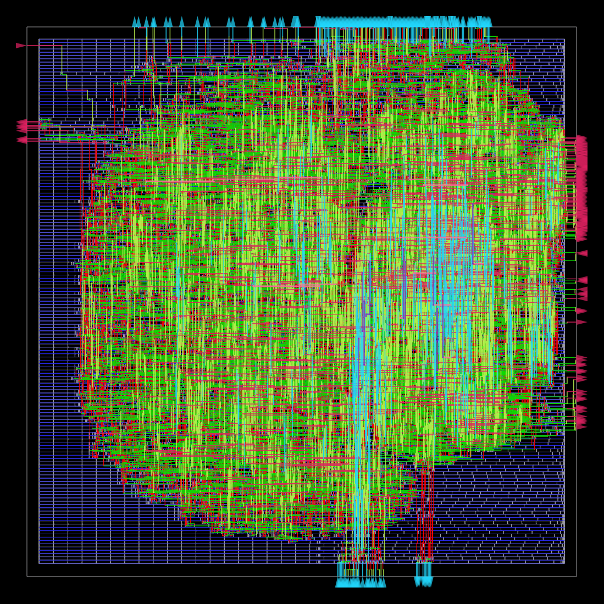

# Routed CPU implementation results

[Run 38275281036](https://github.com/gowthamaruthi/rv32i-single-cycle/actions/runs/38275281036), source `bd9c994`, completed both layouts. The **baseline job passes** the timing, electrical and KLayout DRC acceptance checks. The area-oriented candidate fails one hold check and is not the selected implementation. The run as a whole is therefore marked failed; the individual job results and summaries distinguish the two.

The selected baseline was reproduced successfully in [run 38277622406](https://github.com/gowthamaruthi/rv32i-single-cycle/actions/runs/38277622406), source `41ae955`. Setup slack, hold slack, cell area and estimated power match the baseline values below; KLayout again reports zero markers and the acceptance summary has no errors. LVS remains unsupported.

| Configuration | Cell area (um²) | Setup slack (ns) | Hold slack (ns) | Vectorless estimated power (mW) | KLayout DRC markers | Decision |
|---|---:|---:|---:|---:|---:|---|
| Baseline | 22495.4 | 3.10515 | 0.00643952 | 2.67727 | 0 | Selected |
| Area-oriented ABC | 22828.7 | 3.37305 | -0.00720968 | 2.80936 | 0 | Rejected: hold violation |

Both use the same RTL, 10 ns clock, 0.1 ns clock uncertainty, 0.1/2 ns minimum/maximum I/O delays, 0.010 pF output load, typical Nangate45 library and pinned container. Power uses default vectorless activity. Cell area excludes filler area and is not die area. Timing covers the core including retirement outputs, with external memories represented only by I/O budgets; it is not CPU-plus-memory timing closure or an Fmax measurement.

The baseline has zero reported setup/hold, capacitance, slew and fanout violations, and zero markers in the bundled KLayout DRC deck. **LVS did not run:** the pinned platform references an absent LVS deck. Nangate45 is a non-manufacturable teaching platform. This is not multi-corner foundry signoff or a tapeout-ready chip.

## Reproduce and inspect

```sh
bash physical/run.sh baseline
# Optional rejected experiment; its hold check returns nonzero.
bash physical/run.sh area
```

The final GDS is `build/physical/results/nangate45/rv32i_core/baseline/6_final.gds`. Full GDS, DEF, netlist, SPEF, database and logs are attached to the workflow run. Checked-in hashes identify the GDS outputs. Reproduction requires Docker and the pinned Linux amd64 image. The flow ran on GitHub Ubuntu runners; it was not run natively on the Mac.

`metrics.json`, `timing.rpt`, `drc.lyrdb`, `summary.json` and version output are retained per variant. The image's OpenROAD version string is `unknown`; `physical/image.txt` pins the actual runtime by digest. `source-sha256.txt` covers the implementation inputs and scripts; they match the successful baseline run. Push CI now runs the selected baseline; the manual workflow retains both choices and the same acceptance checks.

## Repair history

1. [Initial mapping/routing](../physical-initial/) generated GDS with positive timing slack but left capacitance violations.
2. [15% capacitance-repair margin](../physical-cap-repair/) removed electrical violations. KLayout found long-wire antenna markers.
3. A 30 um wire-length repair for data and clock-root paths removed the antenna markers. It increased cell area and estimated power; this was a physical-rule repair, not a power reduction.
4. A later 50 ps hold-margin trial ([run 38277081679](https://github.com/gowthamaruthi/rv32i-single-cycle/actions/runs/38277081679)) hit the CTS hold-buffer limit in the baseline job. The remaining trial was canceled, the margin was reverted, and the passing baseline was retained.



## Platform attribution

The generated layouts incorporate cells from the Nangate Open Cell Library distributed with OpenROAD Flow Scripts. Its [Apache 2.0 license](NANGATE45-LICENSE) is retained here; the platform is intended for research and education and is non-manufacturable. The license copy comes from the upstream Nangate45 platform at ORFS revision `3451ca1f56902a49baf50bb8eba345eb709cf9c8`. Keep this notice and license with redistributed layout artifacts.
